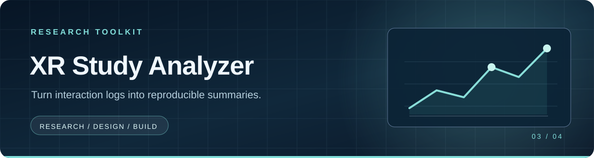

# XR Study Analyzer

A dependency-free Python tool for turning [XR Target Lab](https://github.com/sultanasumaiya/xr-target-lab) CSV exports into readable descriptive summaries. It groups trials by participant code and input mode, then reports movement-time statistics and a reproducible bootstrap interval for the median.

### At a glance

| Input | Output | Requirements |
| :--- | :--- | :--- |
| One or more trial CSV files | JSON summaries per participant and input mode | Python 3.10+, standard library only |

### Run

```bash
python analyze.py examples/trials.csv --seed 42 --iterations 2000
python analyze.py examples/trials.csv --json results.json
python -m unittest discover -s tests -v
```

The included example is **synthetic** and only demonstrates the workflow. Multiple CSV paths may be combined. Each group includes sample size, mean, median, sample standard deviation for `n ≥ 2`, and a 95% percentile bootstrap interval for the median; a single observation has no interval. The seed makes the resampling reproducible.

The script rejects missing required fields, empty inputs, invalid trial numbers, and nonpositive or nonfinite times. A bootstrap interval describes uncertainty under its resampling assumptions; it is not a significance test or a claim that an XR interface improves performance. No real participant data is included.

MIT license.
